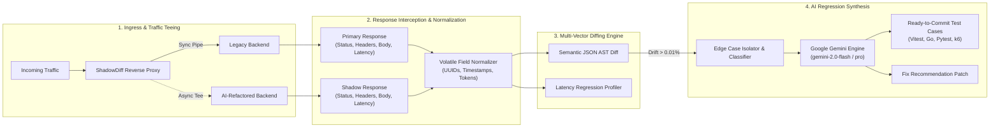

# 🌗 ShadowDiff

### Dual-Traffic Shadow Testing Engine for AI-Refactored Legacy Code

[](https://opensource.org/licenses/MIT)
[](https://golang.org)
[](https://fly.io)
[]()

> **Eliminating the 5% risk that stops enterprise CTOs from deploying AI-modernized backends to production.**

---

## ⚡ The Problem

Enterprises are actively modernizing mission-critical legacy backends (Java 7/8 Spring monoliths, Python 2 Django, PHP 5.6 backends) into modern cloud-native services (Go, TypeScript/Node, FastAPI) using AI code migration engines.

While AI generates ~95% of refactored code accurately, **the remaining 5% of hidden edge cases make production deployment an unacceptable risk**:
* **Subtle Serialization Discrepancies**: Jackson omitting empty lists vs Go serializing `null`, datetime timezone truncations, float precision drift.
* **Implicit Framework Quirks**: Legacy servlet filter quirks, undocumented fallback headers, HTTP 200 responses with embedded error payloads.
* **State Mutation Regressions**: Silent differences in database transaction boundaries or side-effect firing.

---

## 💡 The Solution: ShadowDiff

**ShadowDiff** is a high-performance network proxy that duplicates real staging or production HTTP traffic, sending identical payloads to both the legacy service and the AI-refactored service simultaneously.

```
                           [ Live Inbound Traffic ]
                                      │
                                      ▼
                       ┌─────────────────────────────┐
                       │    ShadowDiff Proxy Core    │
                       └──────────────┬──────────────┘
                                      │
                  ┌───────────────────┴───────────────────┐
                  ▼                                       ▼
        ┌───────────────────┐                   ┌───────────────────┐
        │  Legacy Service   │                   │  AI-Refactored    │
        │     (Target)      │                   │  Service (Shadow) │
        └─────────┬─────────┘                   └─────────┬─────────┘
                  │                                       │
                  │ (Live Response to Client)             │ (Intercepted)
                  │                                       │
                  └───────────────────┬───────────────────┘
                                      ▼
                       ┌─────────────────────────────┐
                       │   Semantic Diff Engine      │
                       │   - JSON AST Tree Diff      │
                       │   - Volatile Field Masking  │
                       │   - Latency Benchmarking    │
                       └──────────────┬──────────────┘
                                      │
                               (Drift Detected)
                                      ▼
                       ┌─────────────────────────────┐
                       │ Automated AI Test Generator │
                       │ - Powered by Google Gemini  │
                       │ - Isolates Request Payload  │
                       │ - Diagnoses Root Cause      │
                       │ - Emits Unit/E2E Test Suite │
                       └─────────────────────────────┘
```

1. **Zero Production Latency Penalty**: Client traffic is served synchronously by the primary legacy service. Shadow traffic is mirrored asynchronously through non-blocking worker pools.
2. **Deep Semantic Diffing**: Compares output JSON responses, latency profiles (P50/P95/P99), and database mutation diffs with tolerance for volatile fields (timestamps, UUIDs).
3. **Automated AI Regression Test Synthesis**: When a drift is detected (> 0.01%), ShadowDiff isolates the edge-case payload and prompts **Google Gemini** to generate turnkey regression test suites (Jest/Vitest, Go, Pytest) and fix suggestions.

---

## 🚀 Fly.io Deployment

ShadowDiff is cloud-ready and can be deployed directly to Fly.io as a lightweight proxy sidecar or standalone gateway:

### 1. Prerequisites
Ensure you have the [Fly CLI installed](https://fly.io/docs/hands-on/install-tools/):
```bash
fly auth login
```

### 2. Configure Secrets
Set the upstream service targets and Google Gemini API key:
```bash
fly secrets set PRIMARY_URL="https://legacy-api.internal"
fly secrets set SHADOW_URL="https://ai-refactored-api.internal"
fly secrets set GEMINI_API_KEY="your-gemini-api-key"
```

### 3. Deploy
Launch using the included `fly.toml`:
```bash
fly launch --now
```

---

## 🏛️ System Architecture



---

## 📄 License

This project is licensed under the [MIT License](LICENSE).
