# 🌗 ShadowDiff

### Dual-Traffic Shadow Testing Engine for AI-Refactored Legacy Code

[](https://opensource.org/licenses/MIT)
[](https://golang.org)
[](https://www.typescriptlang.org)
[]()

> **Eliminating the 5% risk that stops enterprise CTOs from deploying AI-modernized backends to production.**

---

## ⚡ The Problem

Enterprises are rushing to modernize mission-critical legacy backends (Java 7/8 Spring monoliths, Python 2 Django, PHP 5.6 backends) into modern cloud-native services (Go, TypeScript/Node, FastAPI) using AI code migration engines.

While AI generates 95% of refactored code seamlessly, **the remaining 5% of hidden edge cases make production deployment an unacceptable risk**:
* **Subtle Serialization Discrepancies**: Jackson omitting empty lists vs Go serializing `null`, datetime timezone truncations, float precision drift.
* **Implicit Framework Quirks**: Legacy servlet filter quirks, undocumented fallback headers, HTTP 200 responses with embedded error payloads.
* **State Mutation Regressions**: Silent differences in database transaction boundaries or side-effect firing.

**Enterprise leadership cannot afford to risk breaking production traffic on unverified AI code.**

---

## 💡 The Solution: ShadowDiff

**ShadowDiff** is a high-performance network proxy that duplicates real staging or production HTTP traffic, sending identical payloads to both the legacy service and the AI-refactored service simultaneously.

```
                           [ Live Inbound Traffic ]
                                      │
                                      ▼
                       ┌─────────────────────────────┐
                       │    ShadowDiff Proxy Core    │
                       └──────────────┬──────────────┘
                                      │
                  ┌───────────────────┴───────────────────┐
                  ▼                                       ▼
        ┌───────────────────┐                   ┌───────────────────┐
        │  Legacy Service   │                   │  AI-Refactored    │
        │     (Target)      │                   │  Service (Shadow) │
        └─────────┬─────────┘                   └─────────┬─────────┘
                  │                                       │
                  │ (Live Response to Client)             │ (Intercepted)
                  │                                       │
                  └───────────────────┬───────────────────┘
                                      ▼
                       ┌─────────────────────────────┐
                       │   Semantic Diff Engine      │
                       │   - JSON AST Tree Diff      │
                       │   - Volatile Field Masking  │
                       │   - Latency Benchmarking    │
                       └──────────────┬──────────────┘
                                      │
                               (Drift Detected)
                                      ▼
                       ┌─────────────────────────────┐
                       │ Automated AI Test Generator │
                       │ - Isolates Request Payload  │
                       │ - Diagnoses Root Cause      │
                       │ - Emits Unit/E2E Test Suite │
                       └─────────────────────────────┘
```

1. **Zero Production Latency Penalty**: Client traffic is served synchronously by the primary legacy service. Shadow traffic is mirrored asynchronously through non-blocking worker pools.
2. **Deep Semantic Diffing**: Compares output JSON responses, latency profiles (P50/P95/P99), and database mutation diffs with tolerance for volatile fields (timestamps, UUIDs).
3. **Automated AI Regression Test Synthesis**: When a drift is detected (> 0.01%), ShadowDiff isolates the edge-case payload and prompts an LLM to generate turnkey regression test suites (Jest/Vitest, Go, Pytest) and fix suggestions.

---

## 🏛️ System Architecture

ShadowDiff is organized into modular developer infrastructure layers:

```mermaid
flowchart LR
    subgraph Ingress ["1. Ingress & Traffic Teeing"]
        Client["Incoming Traffic"] --> Proxy["ShadowDiff Reverse Proxy"]
        Proxy -->|Sync Pipe| Legacy["Legacy Backend"]
        Proxy -.->|Async Tee| Shadow["AI-Refactored Backend"]
    end

    subgraph Correlator ["2. Response Interception & Normalization"]
        Legacy --> PrimaryResp["Primary Response\n(Status, Headers, Body, Latency)"]
        Shadow --> ShadowResp["Shadow Response\n(Status, Headers, Body, Latency)"]
        PrimaryResp & ShadowResp --> Normalizer["Volatile Field Normalizer\n(UUIDs, Timestamps, Tokens)"]
    end

    subgraph DiffEngine ["3. Multi-Vector Diffing Engine"]
        Normalizer --> ASTDiff["Semantic JSON AST Diff"]
        Normalizer --> PerfDiff["Latency Regression Profiler"]
    end

    subgraph AISynthesis ["4. AI Regression Synthesis"]
        ASTDiff -->|Drift > 0.01%| Triage["Edge Case Isolator & Classifier"]
        Triage --> LLM["LLM Regression Generator\n(Gemini / Claude / OpenAI / Local)"]
        LLM --> Tests["Ready-to-Commit Test Cases\n(Vitest, Go, Pytest, k6)"]
        LLM --> Patch["Fix Recommendation Patch"]
    end

    subgraph Observability ["5. Developer Experience"]
        ASTDiff --> WebUI["Live Stream & Monaco Diff Dashboard"]
        Tests --> WebUI
    end
```



---

## ✨ Key Features

- **⚡ High-Throughput Proxy**: Goroutine-powered asynchronous HTTP request cloning with zero-copy buffers.
- **🛡️ Write-Safety Modes**: Read-only safe mirroring (`GET`/`HEAD`) with sandboxed database schema routing for mutating requests (`POST`/`PUT`/`DELETE`).
- **🔍 Intelligent Normalization**: Built-in entropy filters and configurable JSONPath ignore rules to suppress false positives (dynamic timestamps, session tokens).
- **🤖 Autonomous Test Generation**: Turns every captured production edge-case bug into a regression test file before deployment.
- **📊 Real-Time Developer Dashboard**: Interactive side-by-side Monaco diff visualizer, drift analytics, and 1-click test export.
- **🔒 Enterprise-Grade Privacy**: Automatic PII and credential redaction (`Authorization`, `Cookie`, credit card / SSN patterns) before any prompt payload reaches the LLM.

---

## 🗺️ Roadmap & Milestones

- [x] **Milestone 1**: Architecture blueprint, repository setup, and design specifications.
- [ ] **Milestone 2**: Core reverse proxy engine with asynchronous traffic teeing and trace ID correlation.
- [ ] **Milestone 3**: Semantic JSON comparator and flexible field normalization rules.
- [ ] **Milestone 4**: Automated LLM prompt orchestration for multi-framework regression test synthesis.
- [ ] **Milestone 5**: Real-time web observability dashboard with interactive Monaco diff viewer.
- [ ] **Milestone 6**: Sandboxed database state verification and Kubernetes/Envoy sidecar deployment templates.

For the full architectural plan, see [Master Architectural Plan](docs/ARCHITECTURE.md).

---

## 🛠️ Tech Stack

* **Proxy Core**: Go / Node.js
* **Diff Engine**: Tree AST Semantic Matcher
* **AI Engine**: Gemini 2.0 Flash / Pro, Claude 3.5 Sonnet, OpenAI, Ollama
* **Dashboard**: Next.js 15, React 19, Tailwind CSS, Monaco Diff Editor
* **Storage**: SQLite (WAL) / DuckDB for local, ClickHouse/Redis for distributed

---

## 📄 License

This project is licensed under the [MIT License](LICENSE).
