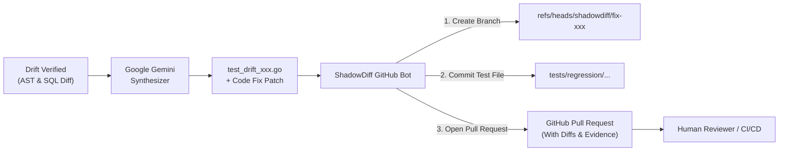
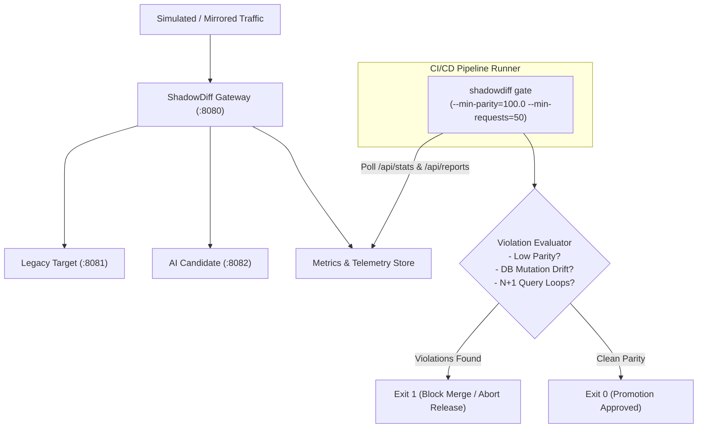

# ShadowDiff: System Architecture Specification

## 1. Overview
ShadowDiff is a 3-way differential shadow testing proxy and automated regression synthesis engine designed for safe enterprise legacy migration verification.

---

## 2. The 3-Way Differential Architecture (Diffy Model)

To eliminate false positives caused by non-deterministic fields (timestamps, ephemeral tokens, dynamic UUIDs) without requiring brittle manual regex rules, ShadowDiff implements mathematical 3-way differential analysis:

```
                          [ Live Inbound Traffic ]
                                     │
                                     ▼
                      ┌─────────────────────────────┐
                      │    ShadowDiff Proxy Core    │
                      └───────┬──────┬──────┬───────┘
                              │      │      │
            ┌─────────────────┘      │      └─────────────────┐
            ▼                        ▼                        ▼
 ┌─────────────────────┐  ┌─────────────────────┐  ┌─────────────────────┐
 │ Primary Instance A  │  │ Primary Instance B  │  │ Candidate Instance  │
 │  (Target Baseline)  │  │   (Twin Baseline)   │  │   (AI-Refactored)   │
 └──────────┬──────────┘  └──────────┬──────────┘  └──────────┬──────────┘
            │                        │                        │
            │   Primary Response     │    Twin Response       │    Shadow Response
            │         (P1)           │        (P2)            │         (S)
            └───────────┬────────────┴──────────┬─────────────┘
                        │                       │
                        ▼                       ▼
            ┌──────────────────────┐┌──────────────────────┐
            │   Noise Evaluator    ││   Candidate Diff     │
            │     N = P1 ⊕ P2      ││     R = P1 ⊕ S       │
            └───────────┬──────────┘└───────────┬──────────┘
                        │                       │
                        └───────────┬──────────┘
                                    ▼
                      ┌───────────────────────────┐
                      │    Noise Cancellation     │
                      │       D = R \ N           │
                      │  (Pure Semantic Drifts)   │
                      └─────────────┬─────────────┘
                                    │
                         (Pure Regressions Only)
                                    ▼
                      ┌───────────────────────────┐
                      │ Google Gemini Synthesizer │
                      │ - Root Cause Diagnosis    │
                      │ - Regression Test (Go/JS) │
                      │ - Code Fix Recommendation │
                      └───────────────────────────┘
```

### Mathematical Formulation
1. **Inherent Baseline Noise**:
   $$\mathcal{N} = P_1 \oplus P_2$$
   Any field diverging between identical twin baseline instances is guaranteed to be non-deterministic runtime noise.

2. **Raw Candidate Divergence**:
   $$\mathcal{R} = P_1 \oplus S$$

3. **Pure Semantic Regression**:
   $$\mathcal{D} = \mathcal{R} \setminus \mathcal{N}$$
   By subtracting the noise set $\mathcal{N}$ from candidate drifts $\mathcal{R}$, ShadowDiff guarantees zero false alarms. Only genuine contract regressions reach the AI test synthesizer.

---

## 3. SQL Mutation & Database Side-Effect Diffing Engine

In enterprise monolith modernizations, an AI-refactored service may return an identical `200 OK` JSON response while introducing catastrophic silent database corruption. 

ShadowDiff implements a dedicated **SQL Mutation Interceptor & Comparator**:

```
 ┌─────────────────────────────────┐       ┌─────────────────────────────────┐
 │ Legacy Monolith (e.g. Java/PHP) │       │ AI-Refactored Service (Go/Node) │
 └────────────────┬────────────────┘       └────────────────┬────────────────┘
                  │ [SQL Executions]                        │ [SQL Executions]
                  ▼                                         ▼
      ┌───────────────────────┐                 ┌───────────────────────┐
      │  Legacy SQL Trace     │                 │   Shadow SQL Trace    │
      │  - BEGIN TRANSACTION  │                 │  - UPDATE inventory   │
      │  - UPDATE inventory   │                 │  - SELECT disc (x4)   │
      │  - INSERT audit_logs  │                 │    (Missing BEGIN!)   │
      │  - COMMIT             │                 │    (Missing Audit!)   │
      └───────────┬───────────┘                 └───────────┬───────────┘
                  │                                         │
                  └───────────────────┬─────────────────────┘
                                      ▼
                      ┌───────────────────────────────┐
                      │  SQL Mutation Diff Engine     │
                      │  - Missing Table Writes       │
                      │  - N+1 Query Explosion        │
                      │  - Transaction Boundary Check │
                      │  - Parameter Value Drift      │
                      └───────────────┬───────────────┘
                                      │
                           (Database Discrepancy)
                                      ▼
                      ┌───────────────────────────────┐
                      │  Google Gemini ORM Diagnosis  │
                      │  - Generates DB rollback test │
                      │  - Suggests @Transactional    │
                      │  - Emits eager loading patch  │
                      └───────────────────────────────┘
```

### Key Detection Capabilities
* **Missing Database Mutations (`MISSING_DB_MUTATION`)**: Flags when legacy writes to tables (e.g. `audit_logs`, `ledger_entries`) that the modern code forgot to mutate.
* **Transaction Boundary Leaks (`MISSING_TRANSACTION_BOUNDARY`)**: Detects when legacy code operated inside atomic `BEGIN...COMMIT` blocks, but refactored ORM code ran autocommit statements vulnerable to partial failures.
* **N+1 Query Explosion (`N_PLUS_ONE_QUERY_EXPLOSION`)**: Detects when refactored ORMs query relational tables in loops ($K \ge 3$ queries) instead of single joined batch queries.
* **Parameter Value Drift (`DB_PARAM_VALUE_DRIFT`)**: Compares bound SQL parameter values across matching statements.

---

## 4. Autonomous Closed-Loop GitHub PR Bot Pipeline

ShadowDiff transforms detected regressions directly into actionable Git artifacts:



### Automation Lifecycle
1. **Branch Creation**: Queries GitHub REST API for default branch head SHA and creates `shadowdiff/fix-<trace_id>`.
2. **Atomic Test Commit**: Encodes the generated test file into Base64 and commits to `tests/regression/test_drift_<trace_id>.go`.
3. **Structured PR Assembly**: Assembles a formatted Markdown Pull Request containing:
   - Request metadata (HTTP route, trace ID, timestamp).
   - Side-by-side JSON contract diff table.
   - Database mutation and N+1 query warning matrix.
   - Google Gemini root-cause diagnosis and suggested ORM patch.
   - Local reproduction CLI command (`go test -v ./tests/regression/...`).
4. **Trigger Modes**: Available via full automation (`-auto-pr=true`) or on-demand with a single click in the Web Console.

---

## 5. CI/CD "Shadow Gating" Architecture (`shadowdiff gate`)

The **Shadow Gating Evaluator** serves as a hard quality gate in pre-release soak testing, staging deployments, or pull request pipelines:



### Evaluation Criteria
* **Traffic Adequacy**: Requires a minimum request quorum (`-min-requests`) before declaring a gate passed.
* **Deterministic Contract Parity**: Reconciles pure regressions against noise cancellation, ensuring only true contract divergence causes build failures.
* **Side-Effect & Mutation Zero-Tolerance**: Rejects any build that introduces uncommitted transactions, dropped audit writes, or N+1 query loops.
* **Dual Output Modes**: Supports rich ANSI styled terminal summaries and machine-readable JSON for integration with Datadog, GitHub Checks API, or Slack webhooks.

---

## 6. Ephemeral Copy-on-Write (CoW) Database Sandboxing

Shadowing mutating HTTP requests (`POST`, `PUT`, `DELETE`, `PATCH`) to candidate services presents severe risk of database pollution and double-charging. ShadowDiff provides three sandboxing strategies:

```
                           [ Inbound Mutating Write (POST/PUT/DELETE) ]
                                                │
                                                ▼
                                ┌───────────────────────────────┐
                                │      ShadowDiff Gateway       │
                                └───────────────┬───────────────┘
                                                │
                       ┌────────────────────────┴────────────────────────┐
                       ▼                                                 ▼
             ┌───────────────────┐                             ┌───────────────────┐
             │  Primary Target   │                             │  Candidate Target │
             │   (Writes to DB)  │                             │  (Shadow Request) │
             └─────────┬─────────┘                             └─────────┬─────────┘
                       │                                                 │
                       │                                [Injected: X-ShadowDiff-Sandbox-ID]
                       ▼                                                 ▼
             ┌───────────────────┐                             ┌───────────────────┐
             │  Primary Database │                             │ Ephemeral Sandbox │
             │  (Committed State)│                             │ - Savepoint ROLLBACK
             └───────────────────┘                             │ - Ephemeral Schema
                                                               │ - Serverless CoW Branch
                                                               └───────────────────┘
```

### Supported Sandboxing Modes
1. **Mode Rollback (`rollback`)**:
   - Assigns an ephemeral transaction boundary header (`X-ShadowDiff-Sandbox-ID: sbx_<trace_id>`).
   - Shadow database interceptor opens a dedicated transactional savepoint and executes an automatic `ROLLBACK` when the shadow cycle concludes.
   - Zero persistent database pollution without extra infrastructure overhead.
2. **Mode Ephemeral Schema (`schema`)**:
   - Provisions an isolated schema (e.g. `shadow_sbx_<trace_id>`) with cloned table definitions for each test run.
   - Safely executes writes and automatically drops the schema upon test completion.
3. **Mode Serverless CoW Branching (`neon`)**:
   - Coordinates with Neon / Supabase serverless PostgreSQL APIs to provision instant, zero-storage copy-on-write database branches.
   - The shadow candidate runs directly against the ephemeral CoW branch; branch is instantly deprovisioned after evaluation.

---

## 7. Developer UI & Telemetry
- Real-time side-by-side comparison across $P_1$, $P_2$, and $S$.
- Visual SQL execution timeline with color-coded operation tags (`[INSERT]`, `[UPDATE]`, `[BEGIN]`).
- Ephemeral DB Sandbox (CoW) isolation telemetry card and per-trace session badges.
- One-click CI/CD Quality Gate CLI command generator modal.
- Automatic alerts for N+1 query patterns and missing mutations.
- One-click regression test copy and GitHub Pull Request opening.

---

## 8. Cloud Production Deployment & Live Sandbox (Fly.io)

ShadowDiff is packaged as a minimal multi-stage Alpine container (image size ~8.6 MB) deployed on **Fly.io**:
- **Live Sandbox URL**: `https://shadowdiff-demo.fly.dev`
- **Embedded Mock Topology**: Runs in-process baseline ($P_1$), twin ($P_2$), and shadow ($S$) mock instances when `DEMO_MODE=true`.
- **Self-Driving Traffic Simulator**: Generates realistic traffic across 5 edge-case scenarios every 3 seconds to keep live metrics, noise cancellation filters, and SQL mutation timelines active for external evaluation.
- **Zero-Downtime High Availability**: Multi-machine autoscaling with automatic stop/start machine configuration (`min_machines_running = 1`).
